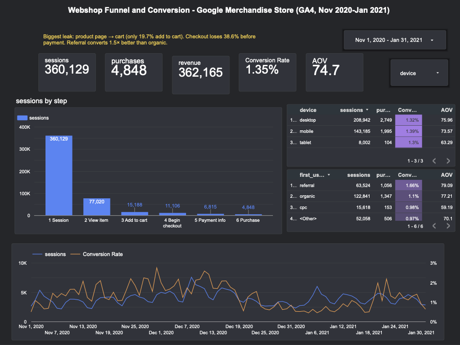

# Webshop Funnel, Conversion & A/B Test Analysis (GA4 · BigQuery · Looker Studio)

**Business questions:** Where does an e-commerce webshop lose buyers, which channels bring customers who convert, and should we ship a new landing page?

**Live dashboard:** [Webshop Funnel & Conversion Dashboard]([DASHBOARD_LINK_HERE](https://datastudio.google.com/s/gxl8yxJdkfk))
https://datastudio.google.com/s/gxl8yxJdkfk

## Key findings

1. **The biggest leak is product page → cart.** Only **19.7%** of sessions that view a product add it to the cart (80.3% drop-off).
2. **Payment is the weakest checkout step.** **38.6%** of shoppers who begin checkout leave before entering payment info, compared with 26.9% drop-off from cart to checkout and 28.9% from payment to purchase.
3. **Device isn't the problem.** Conversion is almost identical across desktop (1.32%), mobile (1.39%) and tablet (1.30%), so a mobile-only redesign wouldn't address the leak.
4. **Referral traffic converts about 1.5× better than organic** (1.66% vs 1.10%), even though organic brings the most sessions.
5. **The new landing page should not be shipped.** In an A/B test with 290,584 users it converted at 11.88% vs 12.04% for control (−0.16 pp, p = 0.19). The 95% CI of the lift (−0.39 pp to +0.08 pp) rules out any meaningful gain.

**Overall (Nov 2020 – Jan 2021):** 360,129 sessions · 4,848 purchases · $362,165 revenue · **1.35% conversion rate** · **$74.70 average order value**

## Recommendations

- Put optimisation effort into the **product page** (add-to-cart prompts, stock and delivery info, reviews) and the **payment step** (fewer fields, more payment options, trust signals). Then A/B test those changes.
- Look into what makes **referral traffic** convert better, and test more spend or partnerships there.
- **Keep the current landing page.** Test bolder changes aimed at the biggest funnel leak instead.

## Part 1: GA4 funnel analysis

**Data:** [`bigquery-public-data.ga4_obfuscated_sample_ecommerce`](https://developers.google.com/analytics/bigquery/web-ecommerce-demo-dataset), the GA4 BigQuery export of the Google Merchandise Store (Nov 2020 – Jan 2021).

**Funnel**

| Step | Sessions | Continue to next step | Drop-off |
|---|---:|---:|---:|
| Session | 360,129 | 21.4% | 78.6% |
| View item | 77,020 | 19.7% | **80.3%** |
| Add to cart | 15,188 | 73.1% | 26.9% |
| Begin checkout | 11,106 | 61.4% | **38.6%** |
| Payment info | 6,815 | 71.1% | 28.9% |
| Purchase | 4,848 | | |

**Conversion by device**

| Device | Sessions | Purchases | Conversion | AOV |
|---|---:|---:|---:|---:|
| Desktop | 208,942 | 2,749 | 1.32% | $75.96 |
| Mobile | 143,185 | 1,995 | 1.39% | $73.57 |
| Tablet | 8,002 | 104 | 1.30% | $63.29 |

**Conversion by first-user channel**

| Channel | Sessions | Purchases | Conversion | AOV |
|---|---:|---:|---:|---:|
| Organic | 122,841 | 1,347 | 1.10% | $77.21 |
| (none) / direct | 83,459 | 1,079 | 1.29% | $73.82 |
| Referral | 63,524 | 1,056 | 1.66% | $79.09 |
| Other | 52,058 | 506 | 0.97% | $70.10 |

**Method**
- [`sql/01_sessions.sql`](sql/01_sessions.sql): GA4 exports one row per *event*. I rebuilt **sessions** by extracting `ga_session_id` from the nested `event_params` with `UNNEST`, then flagged each funnel event per session.
- [`sql/02_funnel_dropoff.sql`](sql/02_funnel_dropoff.sql): funnel counts, conversion rate, AOV and step-to-step drop-off.
- [`sql/03_device_channel.sql`](sql/03_device_channel.sql): breakdowns by device and first-user channel.
- [`sql/04_dashboard_views.sql`](sql/04_dashboard_views.sql): reporting views behind the Looker Studio dashboard. The dashboard has KPI scorecards, the funnel, a daily trend, device and channel tables, and date and device filters.

To run it yourself, replace `YOUR_PROJECT` with your Google Cloud project ID. The free BigQuery sandbox is enough, but create the dataset in the **US** location.

## Part 2: A/B test evaluation

**Data:** the public e-commerce landing-page experiment `ab_data.csv` (Kaggle), comparing an old page (control) with a new page (treatment).

**Notebook:** [`notebooks/ab_test_evaluation.ipynb`](notebooks/ab_test_evaluation.ipynb)

| | Users | Conversions | Conversion rate | 95% CI |
|---|---:|---:|---:|---|
| Control (old page) | 145,274 | 17,489 | 12.04% | 11.87% – 12.21% |
| Treatment (new page) | 145,310 | 17,264 | 11.88% | 11.71% – 12.05% |

- **Data quality:** removed 3,893 rows where the group and the page shown didn't match, plus 1 duplicate user (294,478 → 290,584 users).
- **Test:** two-proportion z-test, z = −1.31, **p = 0.19** (not significant at α = 0.05).
- **Lift:** −0.16 pp absolute (−1.3% relative). 95% CI of the lift: **−0.39 pp to +0.08 pp**.
- **Decision:** don't ship. Even the best case in the confidence interval is a negligible gain.

## Caveats

- Funnel steps are flagged per session **without enforcing order**, so a few sessions record a purchase without a logged `add_payment_info` event.
- The GA4 sample dataset is **obfuscated** by Google. Some fields show `(data deleted)` or `<Other>`, and totals don't represent the real store.
- Channel is **first-user medium** (the user's acquisition channel), not the medium of each session.
- The A/B dataset is a separate, public experiment. It wasn't run on the Merchandise Store.

## Tools

SQL (BigQuery) · Google Analytics 4 data model · Looker Studio (Data Studio) · Python (pandas, statsmodels) · Google Colab
